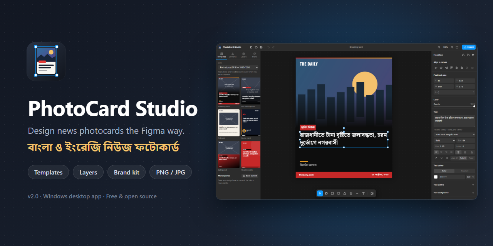
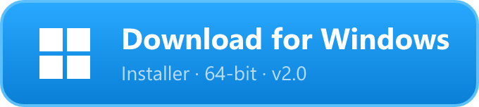
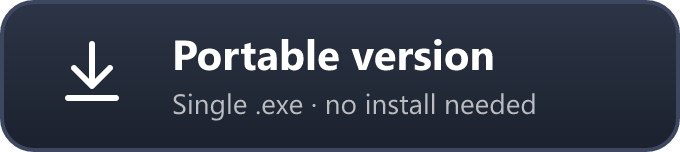
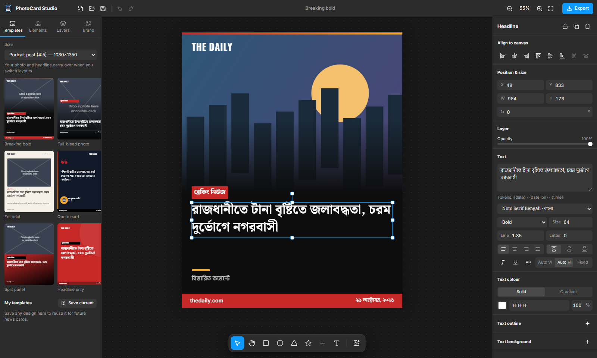

<p align="center">
  
</p>

<h1 align="center">PhotoCard Studio</h1>

<p align="center">
  <b>A Figma-style desktop editor for news photocards, for Bangla and English.</b><br />
  বাংলা ও ইংরেজি নিউজ ফটোকার্ড তৈরির জন্য একটি সহজ, শক্তিশালী ডিজাইন টুল।
</p>

<p align="center">
  <a href="https://github.com/abdullah-al-faahim/photocard-studio/releases/latest/download/PhotoCard-Studio-Setup.exe">
    
  </a>
  &nbsp;
  <a href="https://github.com/abdullah-al-faahim/photocard-studio/releases/latest/download/PhotoCard-Studio-Portable.exe">
    
  </a>
</p>

<p align="center">
  <sub>Windows 10 / 11 · 64-bit · <a href="https://github.com/abdullah-al-faahim/photocard-studio/releases">All releases &amp; changelog</a></sub>
</p>

---

## Contents

- [Features](#features)
- [Installation](#installation)
- [Quick start: your first card in 2 minutes](#quick-start-your-first-card-in-2-minutes)
- [Working guide](#working-guide)
- [Keyboard shortcuts](#keyboard-shortcuts)
- [Troubleshooting](#troubleshooting)
- [For developers](#for-developers)
- [License](#license)

---

## Features

| | |
| --- | --- |
| 🎨 **Free-form canvas** | Every element is its own layer, and you can move, resize, rotate, recolour, hide or lock any of them, the same way you would in Figma. |
| 📰 **News templates** | Six ready layouts: *Breaking bold*, *Full-bleed photo*, *Editorial*, *Quote card*, *Split panel*, *Headline only*. They adapt to any size. |
| 🔤 **Bangla-first typography** | Six Bangla fonts (Noto Serif Bengali, Hind Siliguri, Tiro Bangla, Baloo Da 2, Anek Bangla, Noto Sans Bengali) plus ten English ones. Conjuncts render correctly. |
| 🖼️ **Smart photo slots** | Drop a photo onto a slot to fill it. Then adjust zoom, position, brightness, contrast, blur or black & white. |
| 🏷️ **Brand kit** | Set your logo, outlet name, website and colours once. Every template and element uses them. |
| 🧲 **Precise layout tools** | Snapping guides, align & distribute, box selection, numeric position/size, rotation snapping. |
| ✨ **Rich styling** | Solid or gradient fills, strokes, rounded corners, shadows, text outlines and text background boxes. |
| 📅 **Live date tokens** | `{date_bn}`, `{date}` and `{time}` always show today's date. |
| 📐 **Every social size** | Square, 4:5 portrait, 9:16 story, Facebook link, 16:9, X/Twitter, or custom. |
| 💾 **Save, reuse, export** | `.pcard` design files, your own saved templates, autosave, and PNG/JPG export at up to 3×. |

---

## Installation

### Option 1: Installer (recommended)

1. Click **Download for Windows** above to get `PhotoCard-Studio-Setup.exe`.
2. Open the file. If Windows shows **“Windows protected your PC”**, click **More info → Run anyway**. The app isn't code-signed yet, so Windows doesn't recognise it.
3. Choose an install folder and click **Install**.
4. Open **PhotoCard Studio** from the Start menu or the desktop shortcut.

### Option 2: Portable (no install)

1. Click **Portable version** above to get `PhotoCard-Studio-Portable.exe`.
2. Put it anywhere you like (Desktop, a USB drive…) and double-click it to run.

### Requirements

- Windows 10 or 11, 64-bit
- An internet connection the first time you open the app, so it can download fonts

### Uninstalling

Go to **Settings → Apps → Installed apps → PhotoCard Studio → Uninstall**. For the portable version, just delete the `.exe`.

---

## Quick start: your first card in 2 minutes

1. **Pick a layout.** In the **Templates** tab (left), choose a size, then click a template.
2. **Add the photo.** Drag a photo from File Explorer onto the grey *“Drop a photo here”* slot. You can also double-click the slot, or copy an image and press <kbd>Ctrl</kbd>+<kbd>V</kbd>.
3. **Write the headline.** Double-click the headline on the canvas, type, then press <kbd>Esc</kbd>.
4. **Tweak.** Click anything to select it, and change its font, colour or size in the panel on the right.
5. **Export.** Click **Export** (top right), choose PNG or JPG and a resolution, and save.

> 💡 Set up your logo and colours once in the **Brand** tab. Every template you pick after that uses them.

---

## Working guide

<p align="center"></p>

### The workspace

| Area | What it's for |
| --- | --- |
| **Top bar** | New, open, save, undo/redo, zoom controls and **Export**. |
| **Left panel** | **Templates**, **Elements** (text styles, news badges, shapes, photo upload), **Layers**, and **Brand**. |
| **Canvas** | Your card. Scroll to pan, <kbd>Ctrl</kbd> + scroll to zoom, hold <kbd>Space</kbd> and drag to move around. |
| **Toolbar** (bottom) | Move, Hand, Rectangle, Ellipse, Triangle, Star, Line, Text, Add photo. |
| **Right panel** | Properties of whatever is selected. With nothing selected, it shows the canvas size and background. |

### Templates and sizes

- Pick a size from the dropdown in **Templates**, then click a layout. The template re-flows to fit that size.
- **Your content carries over.** Switching templates keeps your photo, headline, tag and summary, so you can try several layouts quickly.
- To make your own template, design a card, then click **My templates → Save current**. It shows up in that list from then on.
- **New design** (top-left ＋ icon) starts fresh at any size, from a template or a blank canvas.

### Photos

- **Add:** drag files onto the canvas, paste with <kbd>Ctrl</kbd>+<kbd>V</kbd>, use **Elements → Upload photo**, or use the 🖼️ toolbar button.
- **Fill a slot:** drop a photo straight onto an existing photo layer to replace it.
- **Frame it:** in the right panel, use **Fill / Fit / Stretch**, **Zoom**, and the **Horizontal / Vertical position** sliders to choose what part of the photo shows.
- **Adjust:** brightness, contrast, blur, black & white, rounded corners and a border.
- **Replace:** double-click a photo, or click **Replace photo**.

### Text

- **Edit:** double-click text on the canvas (or select it and press <kbd>Enter</kbd>). Press <kbd>Esc</kbd> or click outside to finish.
- **Add:** press <kbd>T</kbd> and click on the canvas, or use **Elements → Text**.
- **Style:** font, weight, size, line height, alignment (including vertical), italic, underline, UPPERCASE, solid or gradient colour, outline and shadow.
- **Tag boxes:** under **Text background**, click **＋** to put a coloured box behind the text. Padding and corner radius are adjustable, which is how the red *ব্রেকিং নিউজ* tags are made.
- **Sizing modes:**
  - **Auto W:** the box grows sideways with the text (good for tags).
  - **Auto H:** fixed width, height grows (good for headlines).
  - **Fixed:** the box keeps its size.
- **Dates:** type `{date_bn}` (২৯ অক্টোবর, ২০২৬), `{date}` (29 October 2026) or `{time}`. They update automatically every day.

### Shapes and news elements

- Draw with the toolbar: <kbd>R</kbd> rectangle, <kbd>O</kbd> ellipse, <kbd>L</kbd> line, plus triangle and star. Hold <kbd>Shift</kbd> for perfect squares and circles, or 45° lines.
- **Elements** has ready-made news pieces: breaking tag, live badge, lower bar, photo shade (gradient), photo slot, logo, quote mark and accent line.
- Every shape supports solid or gradient fill, stroke, corner radius and shadow.

### Selecting, arranging and layers

- Click to select. <kbd>Shift</kbd>+click to add to the selection. Drag on an empty area to box-select.
- Drag the handles to resize, and the circle above the box to rotate.
- Pink guides appear when an edge or centre lines up with the canvas or another layer.
- Use the **Align** buttons in the right panel (with one layer selected, it aligns to the canvas). **Distribute** needs 3 or more layers.
- The **Layers** tab lets you drag to reorder, double-click to rename, and lock or hide layers with the icons.
- Right-click anything for copy, paste, duplicate, layer order, lock, hide and delete.

### Brand kit

Open **Brand** and set your **outlet name**, **website**, **logo** (a transparent PNG works best), **primary / secondary colours** and the **template language** (বাংলা or English). New templates and elements use these automatically.

### Saving and opening

- **Save** (<kbd>Ctrl</kbd>+<kbd>S</kbd>) writes a `.pcard` file. Photos are included, so the file is self-contained and can be shared.
- **Open** (<kbd>Ctrl</kbd>+<kbd>O</kbd>) loads a `.pcard` file.
- Your current work is also **autosaved**, so it's still there the next time you open the app.

### Exporting

Click **Export** (<kbd>Ctrl</kbd>+<kbd>E</kbd>):

- **PNG:** sharpest text, best for most posts.
- **JPG:** smaller files, good for Facebook and WhatsApp. You can set the quality.
- **Resolution:** 0.5×, 1×, 2× or 3× the canvas size. 1080×1350 at 2× gives 2160×2700.

Only the card itself is exported. Selection boxes and guides never show up in the image.

---

## Keyboard shortcuts

| Action | Shortcut | | Action | Shortcut |
| --- | --- | --- | --- | --- |
| Move tool | <kbd>V</kbd> | | Undo / Redo | <kbd>Ctrl</kbd>+<kbd>Z</kbd> / <kbd>Ctrl</kbd>+<kbd>Y</kbd> |
| Hand tool | <kbd>H</kbd> or hold <kbd>Space</kbd> | | Copy / Paste | <kbd>Ctrl</kbd>+<kbd>C</kbd> / <kbd>Ctrl</kbd>+<kbd>V</kbd> |
| Rectangle | <kbd>R</kbd> | | Duplicate | <kbd>Ctrl</kbd>+<kbd>D</kbd> |
| Ellipse | <kbd>O</kbd> | | Delete | <kbd>Del</kbd> |
| Line | <kbd>L</kbd> | | Select all | <kbd>Ctrl</kbd>+<kbd>A</kbd> |
| Text | <kbd>T</kbd> | | Bring forward / to front | <kbd>Ctrl</kbd>+<kbd>]</kbd> / <kbd>Ctrl</kbd>+<kbd>Shift</kbd>+<kbd>]</kbd> |
| Edit selected text | <kbd>Enter</kbd> | | Send backward / to back | <kbd>Ctrl</kbd>+<kbd>[</kbd> / <kbd>Ctrl</kbd>+<kbd>Shift</kbd>+<kbd>[</kbd> |
| Nudge | Arrows (<kbd>Shift</kbd> ×10) | | Lock / Hide | <kbd>Ctrl</kbd>+<kbd>Shift</kbd>+<kbd>L</kbd> / <kbd>H</kbd> |
| Zoom | <kbd>Ctrl</kbd> + scroll, <kbd>Ctrl</kbd>+<kbd>=</kbd> / <kbd>-</kbd> | | Save / Open | <kbd>Ctrl</kbd>+<kbd>S</kbd> / <kbd>Ctrl</kbd>+<kbd>O</kbd> |
| Zoom to fit / 100% | <kbd>Shift</kbd>+<kbd>1</kbd> / <kbd>Ctrl</kbd>+<kbd>0</kbd> | | Export | <kbd>Ctrl</kbd>+<kbd>E</kbd> |

---

## Troubleshooting

| Problem | Fix |
| --- | --- |
| **“Windows protected your PC”** when installing | Click **More info → Run anyway**. This happens because the app isn't code-signed yet. |
| **Fonts look plain or Bangla looks wrong** | Fonts download from Google Fonts on first launch. Connect to the internet and restart the app. |
| **Letter spacing does nothing on Bangla text** | This is on purpose. Spacing out letters breaks Bangla conjuncts, so it only applies to English text. |
| **The canvas is off-screen or tiny** | Press <kbd>Shift</kbd>+<kbd>1</kbd> (zoom to fit). |
| **“Not enough storage” when saving a template** | Saved templates hold their photos. Remove large photos from the design first, or save it as a `.pcard` file instead. |

---

## For developers

### Run from source

You'll need [Node.js](https://nodejs.org) 18 or newer and Git.

```bash
git clone https://github.com/abdullah-al-faahim/photocard-studio.git
cd photocard-studio
npm install
npm approve-scripts electron   # lets Electron download its binary (npm 11+)
```

| Command | What it does |
| --- | --- |
| `npm run dev` | Live-reloading browser preview at http://localhost:5180 (add `#demo` to load a sample photo) |
| `npm start` | Builds and opens the desktop app |
| `npm run dist` | Builds `release/PhotoCard-Studio-Setup.exe` and `release/PhotoCard-Studio-Portable.exe` |

### Publishing a release

The download buttons at the top always point to the **latest GitHub Release**. To publish one:

1. Bump `version` in `package.json` and run `npm run dist`.
2. On GitHub, open **Releases → Draft a new release**, create a tag such as `v2.0.0`, and attach **both** files from `release/`, keeping their names exactly as built.
3. Publish. The buttons now download the new version.

### Project structure

```
src/
├─ model/      layer model, news templates, sizes & fonts
├─ state/      Zustand store (undo/redo, selection, autosave), brand kit
├─ canvas/     Konva editor: rendering, transform, snapping, text editing
├─ panels/     Templates, Elements, Layers, Brand, Properties, modals
├─ io/         PNG/JPG export and .pcard save/open
└─ ui/         shared controls and keyboard shortcuts
main.js        Electron window + file dialogs
preload.js     safe bridge between the window and the file system
```

Built with [Electron](https://www.electronjs.org), [React](https://react.dev), [Konva](https://konvajs.org), [Zustand](https://zustand.docs.pmnd.rs) and [Lucide](https://lucide.dev) icons.

---

## License

MIT © 2025 Abdullah Al Fahim
